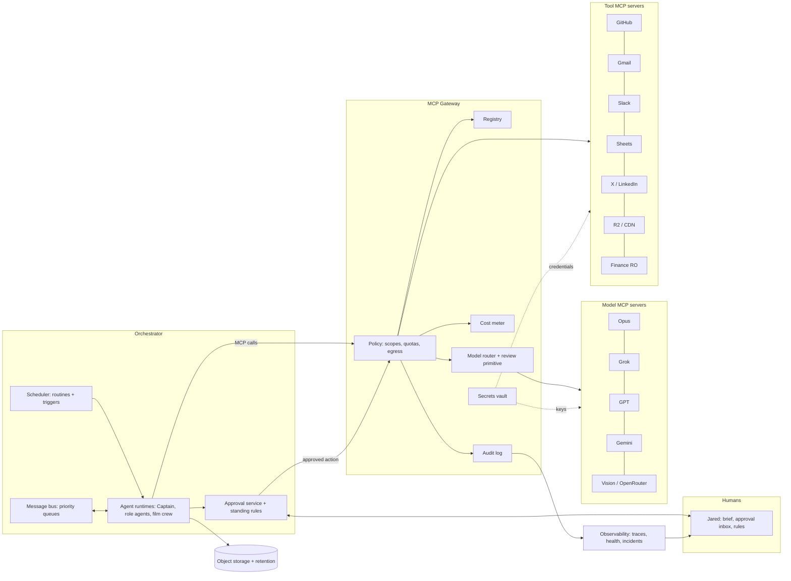

# autonomo.us: Design Doc

*Status: draft v0.1, October 2026. Owner: Jared Wray.*

## 1. Problem and goals

I already run a team of autonomous agents across Hyphen AI, my open source work, personal finance, and the Rustboy short film. It works, but it runs on a loose stack: agents with written remits, cron jobs, a shared disk, connectors wired one at a time, and me as the approval bottleneck. The failures I've hit are not model-quality problems. They come from missing infrastructure: no independent review, no retention, no reliable scheduling, no single place to manage approvals, and no clean way to swap a model or add a tool without editing every agent.

autonomo.us is the platform that replaces that loose stack. The goals:

1. **A flexible MCP layer as the core.** Every model and every tool or service is an MCP server behind one gateway. Agents never hold credentials or call providers directly. Swapping Opus for Grok on the writer role, or adding LinkedIn as a tool, is a registry change, not an agent rewrite.
2. **Human approval as a first-class primitive.** Nothing goes outbound without my approval unless I've written a standing rule that allows it.
3. **Independent review before human review.** No agent judges its own output. Cross-model and vision review gates sit between generation and my inbox.
4. **Operational reliability.** Schedules that recur, agents that can be recovered from state, storage that cleans itself up, and failures that show up in my morning brief instead of being discovered days later.

Non-goals for now: a multi-tenant SaaS, a visual agent builder, or training models. This is built for my businesses first. If it becomes a product, that's a later decision.

## 2. Lessons from the current operating model

The design is grounded in how the team runs today.

**Captain, the chief of staff.** Captain sends me a brief at 6 AM, checks the film project every two hours from 8 AM to 8 PM, and under a standing delegation makes blocking production calls when I don't answer. I still merge PRs. This proved that delegation works when it's written down and scoped, and that one coordinating agent cuts my attention cost sharply. It also showed that delegation needs an audit trail: I want to see every call Captain made on my behalf.

**Role agents with written remits.** Each agent has a plain-language remit and a daily quota: the Hyphen lead generator finds 3–5 LinkedIn targets a day; acquihire outreach writes 3 drafts a day; social engagement drafts X replies and changelog-driven posts; the competitor watcher reports changes; the OSS promoter drafts GitHub comments; the dev manager turns security findings into 5 fix PRs a day using cloud coding agents; the money saver reads personal finance data, read-only. The Rustboy crew (director, writer, shooter, sound, QC, and chronicle, which ships the site and opens daily blog PRs) is a small production pipeline. Remits plus quotas keep agents from drifting or flooding me.

**Everything outbound is a draft.** Email, LinkedIn, X, and GitHub comments all wait for my approval. This rule is non-negotiable and it's the right one, but it created the biggest operational pain: drafts pile up when I'm busy, go stale, and block downstream work.

**Failures I've actually hit:**

- The shared disk filled with QC media. We added a daily 24-hour cleanup by hand. Retention needs to be policy, not a script someone remembers to write.
- A PR reached me with the wrong character because the same agent generated the shot, measured it, and judged it. Self-review is not review.
- An agent became unreachable and had to be recreated from scratch. Agent identity, memory, and remit must live outside the agent's runtime.
- A one-off scheduled run was assumed to be recurring and silently stopped. Schedules need explicit types and a missed-run alarm.
- Uploads to the production CDN needed my approval, but nothing distinguished staging from production writes. Egress needs to be classified by destination.

## 3. Core concepts

**Agent.** A durable identity with a remit, a role, a set of granted scopes, a memory store, and a runtime binding. The runtime (a model session, a cloud coding agent, a script) is disposable; the agent record is not. Recreating an agent means starting a new runtime from the stored record.

**Remit.** A versioned Markdown document stating what the agent is for, what it may do, its quotas, and its escalation path. The remit compiles into machine-enforced pieces: scopes, quotas, and the approval policy. The prose stays the source of truth for intent; the compiled policy is what the gateway enforces.

**Routines and triggers.** A routine is a scheduled job with an explicit type: `recurring` (cron expression), `one_off` (fires once, then shows as completed), or `window` (e.g. every 2 hours between 8 AM and 8 PM Pacific). Triggers are events: a webhook (GitHub PR opened, new email), a message from another agent, a file landing in storage, or an approval decision. Every routine has an expected next run; a missed run is an incident.

**Approval gate.** A checkpoint an artifact must pass before an action executes. Gates are either automated (a review by another model or a vision check) or human (me). Every outbound action passes through at least one human gate unless a standing rule covers it.

**Memory.** Three tiers. Working memory is per-run context and is discarded. Agent memory is durable notes, preferences, and history per agent (e.g. which leads were already contacted). Shared memory is team-level facts: the film's character sheet, brand voice, my standing decisions. Shared memory is read by many agents and written through a reviewed path, so one agent can't silently rewrite the canon.

## 4. The flexible MCP layer

The MCP layer is the core of the system. It's a gateway that every agent talks to over MCP. Behind it, every model provider and every tool is registered as an MCP server. The gateway authenticates the agent, checks scopes, injects credentials, meters cost, enforces egress policy, and logs the call.

**Registry.** Each server has a registry entry: its MCP endpoint, the tools it exposes, a capability tag set (e.g. `text.generate`, `vision.judge`, `email.send`, `storage.write`), an egress class per tool, cost metadata, and health status. Models and tools are registered the same way, which is what makes swapping cheap. Agents request capabilities, not vendors. An agent asks for `email.draft`; whether that's Gmail or something else is a registry binding. Adding a server means registering it, tagging its tools, and granting scopes. No agent changes.

**Secrets vault.** Credentials (OAuth tokens, API keys, OpenRouter keys) live only in the vault. The gateway injects them per call; agents never see them. Tokens are scoped per server and, where the provider allows, per purpose (a read-only Gmail token for triage, a separate one for sending that only the approval service can use). Rotation and revocation happen in one place. A compromised or misbehaving agent can be cut off by revoking its gateway identity without touching any provider credential.

**Model router.** Agents request a role, not a model: `writer`, `reviewer`, `vision_qc`, `coder`, `summarizer`. A routing table maps each role to an ordered list of models with constraints (max cost per call, required modality, context length, data-handling class). Routes can be set globally, per agent, or per task. Fallback is automatic when a provider is down or rate-limited, and the fallback is logged. Models can be reached directly or through OpenRouter; the router treats both as registry entries. Changing the house writer from one model to another is a single table edit.

**Permissions and scopes.** Scopes are granted per agent per tool, with verbs: `read`, `draft`, `write`, `send`, `delete`. The money saver gets `finance:read` and nothing else. The OSS promoter gets `github.comments:draft` but not `github.comments:write`. `send`-class scopes are held by the approval service, not by agents: an agent produces a draft, and only an approved draft is executed, by the gateway, on its behalf. That makes the "everything outbound is a draft" rule structural instead of behavioral. Scopes can also carry quotas (3 outreach drafts per day) and resource filters (only these repos, only this storage bucket).

**Cost metering.** Every call is metered: model tokens and provider price, tool API costs where known, cloud coding agent time, and storage written. Costs roll up per call, per run, per agent, and per routine. Budgets are set per agent and per routine with soft limits (warn in the brief) and hard limits (calls refused, agent paused, Captain notified). A per-call ceiling stops a single runaway request.

**Egress policy.** Every tool action has an egress class: `internal` (our storage, memory), `private-external` (a Slack DM, a draft in Gmail), `public` (a post on X, a GitHub comment, a CDN upload), and `production` (production CDN, merging to main, sending money). Policy is defined per class and per destination: what data classes may flow there (personal finance data never leaves `internal`), whether a human gate is required, and whether a staging alternative exists. Production CDN writes always require approval; staging writes don't. Data classification also applies to model calls: the router won't send a `finance`-tagged context to a model route not cleared for it.

**Cross-model review as a primitive.** Review is a gateway call, not an agent convention: `review(artifact, rubric, reviewer_role)`. The gateway guarantees the reviewer is a different model family from the author (it knows who produced the artifact from the audit log) and, for media, includes a vision model that checks the artifact against reference material such as the character sheet. The reviewer returns pass, fail, or revise with reasons. Workflows declare required reviews: for example, a film shot needs a vision QC pass against the character reference by a model other than the one that generated it, plus an independent measurement step, before chronicle can open a PR. The author agent cannot mark its own work as reviewed. This is the direct fix for the wrong-character PR.

## 5. Orchestration and inter-agent messaging

The orchestrator owns three things: the scheduler, the message bus, and agent lifecycle.

The scheduler stores routines with explicit types and computes the next expected run. It runs a reconciliation loop: any routine whose expected run passed without a recorded start becomes an incident that goes in the brief and, if it's high priority, to Captain immediately. One-off routines show up as "completed, will not recur," so they can't be mistaken for recurring ones.

Agents message each other over a bus with typed messages (request, report, decision, escalation) and a priority flag (`low`, `normal`, `high`, `blocking`). Messages are durable and acknowledged. An unacknowledged `blocking` message escalates to Captain, then to me. Captain subscribes to all escalations and acts under its standing delegation, recording each decision as a `decision` message that I can review and reverse.

Agent lifecycle is health-checked. Each agent heartbeats; a missed heartbeat triggers a restart from the stored record (remit, scopes, memory, in-flight work). The in-flight work is recovered because every unit of work is a durable job with state, not a thought inside a model session. "Recreate the agent" becomes an automatic operation instead of a manual rebuild.

Workflows like the film pipeline are defined as small DAGs: writer → director → shooter/sound → QC (independent, cross-model) → chronicle → PR → me. Each edge can carry a gate. The DAG makes it visible where a shot is stuck.

## 6. Human-in-the-loop UX

I'm the scarcest resource in the system, so the UX is designed around my attention.

**Morning brief.** Captain composes it at 6 AM from structured data, not from memory: what shipped, what's waiting on me (sorted by what it blocks), decisions Captain made under delegation, incidents (missed runs, failed reviews, budget warnings, restarted agents), and spend by agent. It links into the approval inbox rather than duplicating it.

**Approval inbox.** One queue for every pending action across all agents and channels. Items are batched by type so I can approve ten LinkedIn drafts in one pass, with the review results attached (what the reviewer model said, what vision QC checked). Actions are approve, edit-and-approve, reject with reason, or snooze. Reject reasons flow back into the author agent's memory. Every item has an expiry: stale drafts (a reply to a week-old post) expire automatically and are logged, rather than piling up. Items that block other work are pinned to the top.

**Standing rules.** I can turn repeated approvals into rules: "Auto-send X replies from the social agent to accounts I follow, if they passed review and contain no links," or "Captain may approve film production calls under delegation, but not PR merges or production CDN uploads." Rules are scoped, have an expiry or review date, and every action taken under a rule appears in the brief. The inbox suggests rules when it sees me approving the same pattern unchanged repeatedly; I accept or ignore. PR merges and production writes stay human-only by default.

The inbox should be reachable where I already am: a web view, plus Slack and email with approve/reject actions, all backed by the same approval service.

## 7. Storage and retention

All artifacts go to object storage (R2 or equivalent), never a shared local disk. Every object is written with a class that determines retention: `scratch` (deleted after 24 hours, which covers QC media and intermediate renders), `working` (kept for the life of the workflow plus a grace period), `record` (approved outputs, published content, decisions; kept indefinitely), and `sensitive` (finance and personal data; encrypted, minimal retention, never egressed). Lifecycle rules enforce retention at the storage layer. Per-agent storage quotas and a usage line in the brief catch growth before it's a problem. Agents get write access only to their own prefixes plus explicitly shared ones.

Memory lives in a database (Postgres for structured state and agent records, with a vector index for retrieval). Keyv is a natural fit as the key-value interface over the cache and lightweight agent state.

## 8. Observability and failure recovery

Every MCP call, message, routine run, gate decision, and approval is traced with a run ID that ties it back to the agent, routine, and triggering event. From any artifact I should be able to answer: who made this, with which model, what reviewed it, what it cost, and who approved it.

Health signals: agent heartbeats, routine run vs. expected, MCP server health and error rates, queue depth in the approval inbox, storage usage, and spend against budget. Thresholds create incidents. Incidents go to Captain first; Captain can retry, restart an agent, fail over a model route, or pause a routine, and escalates to me when it can't resolve them.

Recovery primitives: restart an agent from its record, replay a job from its last checkpoint, fail over a model or tool route via the registry, revoke an agent's gateway identity, and pause any routine or agent from the inbox. Every action an agent takes goes through the gateway, so the audit log is complete by construction.

## 9. MVP scope

The MVP proves the MCP layer and the approval loop on real work, migrating a few existing agents rather than building everything.

In scope: the MCP gateway with registry, vault, scopes, cost metering, and egress classes; a model router with roles and fallback across at least two providers plus OpenRouter; the `review()` primitive with author/reviewer separation; a scheduler with typed routines and missed-run detection; durable agent records with restart; the approval inbox (web plus Slack) with batching and expiry; object storage with retention classes; the morning brief. Agents migrated: Captain, social engagement, OSS promoter, and the Rustboy QC → chronicle path (it exercises vision review and production CDN gating).

Out of scope for the MVP: standing-rule suggestions, the full film DAG, cloud coding agent orchestration for the dev manager, and anything multi-tenant.

## 10. Roadmap

**Phase 1 (MVP).** As above. Exit criterion: the migrated agents run for a sustained period with no outbound action bypassing a gate, no self-reviewed artifact reaching me, and no silently missed routine.

**Phase 2: full team.** Migrate the remaining agents: lead generator, acquihire outreach, competitor watcher, money saver (read-only finance), dev manager with cloud coding agents, and the full film crew as a DAG. Add standing rules with suggestions, per-agent budgets with hard limits, and shared memory with a reviewed write path.

**Phase 3: hardening.** Policy-as-code for remits, data classification on model routes, replay and checkpointing for long workflows, and a review of which gates can safely become standing rules based on the audit history.

**Phase 4: optional externalization.** Decide whether autonomo.us stays internal, becomes open source (the MCP gateway and router are the obvious candidates), or becomes a product.

## 11. Open questions

1. Build the gateway or extend an existing MCP gateway/proxy? The registry, scopes, and review primitive are the differentiators; transport and auth might be borrowed.
2. Where do agent runtimes execute: our own workers, provider-hosted agent sessions, cloud coding agents, or a mix? This affects how recovery works.
3. How much delegation should Captain get, and how do I review it without it becoming another inbox?
4. What's the right granularity for cross-model review: every artifact, or sampling for low-risk work once a route has a track record?
5. LinkedIn has no clean API for most of what the lead generator does. Is draft-only plus manual send acceptable long term?
6. How should cost be attributed when one workflow spans several agents and businesses (Hyphen vs. OSS vs. film vs. personal)?
7. Which data classes may go to which model providers, and who maintains that mapping as providers change terms?
